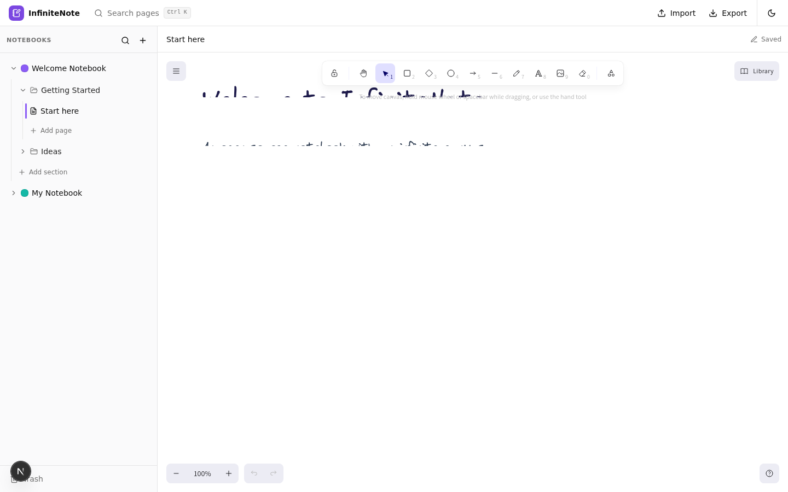
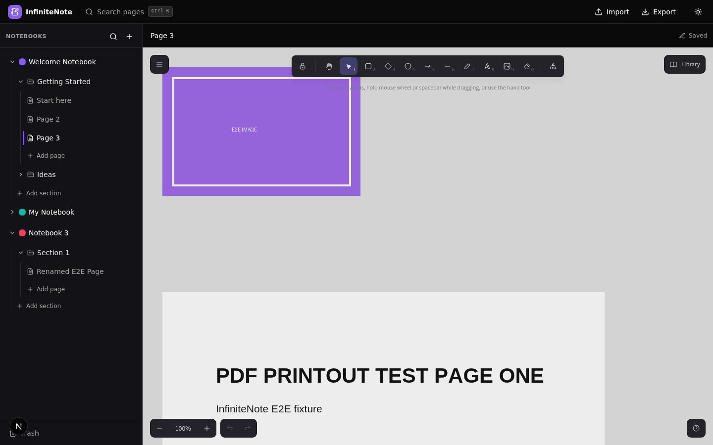
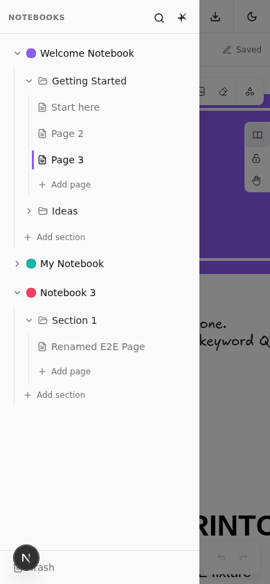

<div align="center">

# InfiniteNote

**Your notes, your canvas — a free, open-source OneNote-style notebook for Linux and Android.**

[](https://github.com/shalosi00/infinitenote/actions/workflows/ci.yml)
[](https://github.com/shalosi00/infinitenote/releases)
[](LICENSE)
[](PROJECT_STATUS.md)

</div>

OneNote is a great notebook — but it is closed-source, tied to Microsoft's cloud, and has
no Linux client. InfiniteNote is the open answer: an infinite-canvas notebook you can
install on Linux and Android, use completely offline, and keep full ownership of your
data. No account, no cloud, no lock-in.

## Features

- **OneNote-style hierarchy** — notebooks, sections and pages; rename, reorder, color.
- **Infinite canvas** — draw, handwrite and type anywhere (Excalidraw engine).
- **Draw on anything** — ink overlays text, images and PDF printouts.
- **Import** — images, plain text, Markdown, PDF (rendered as a printout, multi-page)
  and existing `.excalidraw` scenes.
- **Export** — PNG, SVG, scene JSON, or a full notebook backup file.
- **Search** — instant full-text search across every page (`Ctrl+K`).
- **Trash** — OneNote-style soft delete with restore and purge.
- **Dark mode** and responsive layout with a mobile drawer.
- **Local-first** — data lives in your browser's IndexedDB; works fully offline.
- **Installable PWA** — one tap / one click to install on Linux and Android.

## Screenshots

| Light | Dark |
|:---:|:---:|
|  |  |



## Install

InfiniteNote is a Progressive Web App, so no app store is needed.

1. **Self-host or use a deployment** — `make build` produces a standalone server
   (or deploy to any static/Node host).
2. **Linux** — open the app in Chrome/Chromium/Edge, then menu → *Install app*.
3. **Android** — open the app in Chrome, then menu → *Add to Home screen*.

Your notes are stored on-device and keep working offline.

### Build from source

Requires [bun](https://bun.sh) 1.3+:

```bash
git clone https://github.com/shalosi00/infinitenote.git
cd infinitenote
bun install
bun run db:generate
bun run dev          # http://localhost:3000
```

## Development

| Command | Purpose |
|---|---|
| `make dev` | Run dev server |
| `make test` | Unit tests (47) |
| `make lint` / `make typecheck` | Lint / TypeScript check |
| `make e2e` | E2E suite (34 checks; needs dev server + headless browser) |
| `make status` | Quick "where do things stand" snapshot |

CI runs lint, typecheck, unit tests, a production build and a boot smoke test on
every PR — both are required checks before merge.

- **[PROJECT_STATUS.md](PROJECT_STATUS.md)** — read this first: current state, in-flight work, next up
- **[docs/ARCHITECTURE.md](docs/ARCHITECTURE.md)** — stack, modules, data flow
- **[docs/PIPELINE.md](docs/PIPELINE.md)** — branching, PRs, releases; see also [CONTRIBUTING.md](CONTRIBUTING.md)
- **[docs/ROADMAP.md](docs/ROADMAP.md)** and **[docs/DECISIONS.md](docs/DECISIONS.md)** — what is next and why things are the way they are
- **[AGENTS.md](AGENTS.md)** — guide for AI agents and contributors

## Acknowledgements

Built on outstanding open source: [Excalidraw](https://excalidraw.com) (canvas),
[Dexie](https://dexie.org) (IndexedDB), [pdf.js](https://mozilla.github.io/pdf.js/),
[shadcn/ui](https://ui.shadcn.com), [Next.js](https://nextjs.org) and [bun](https://bun.sh).
Inspired by Microsoft OneNote; not affiliated with or endorsed by Microsoft.

## License

[MIT](LICENSE) — © 2026 Tiana and InfiniteNote contributors
