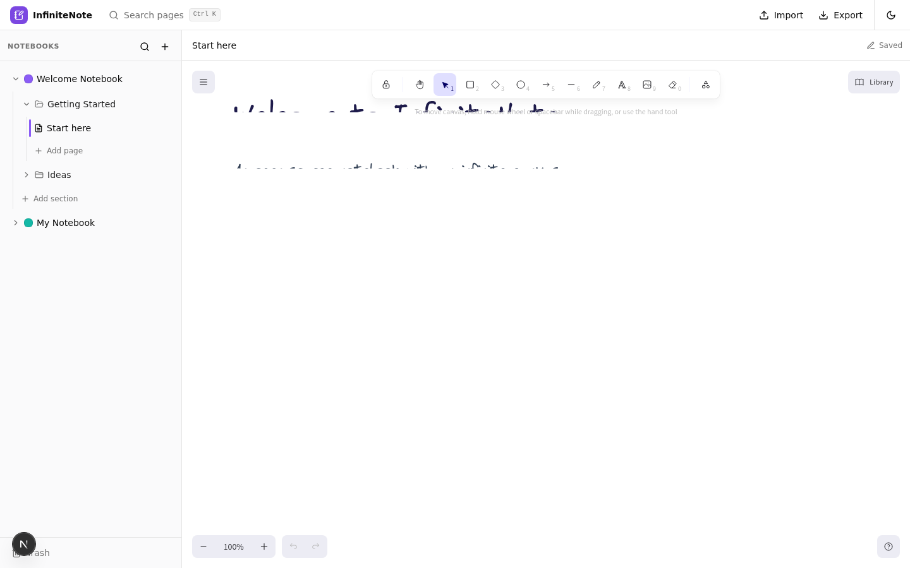
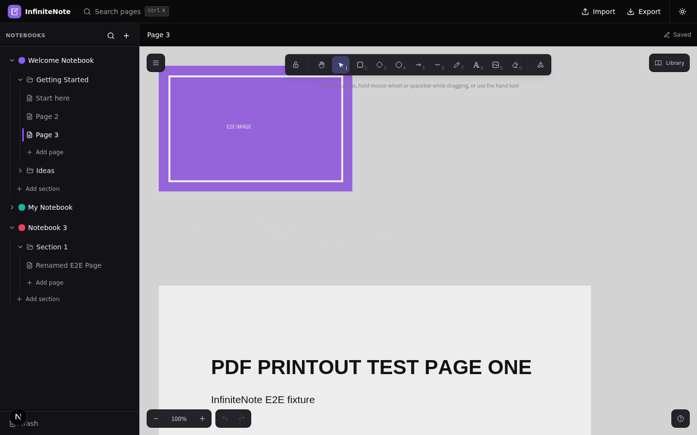
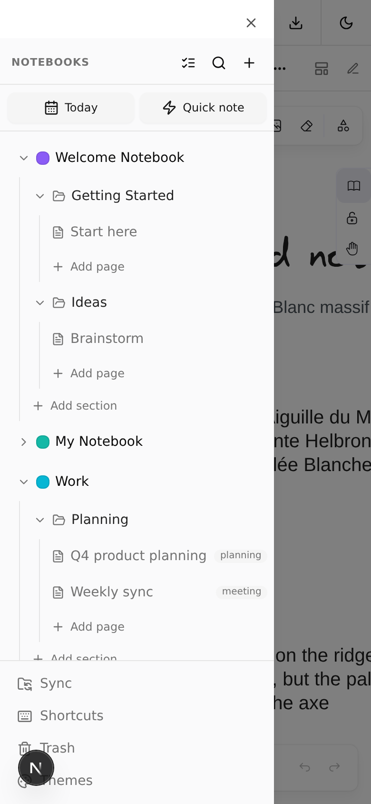

<div align="center">

# InfiniteNote

**Your notes, your canvas — a free, open-source OneNote-style notebook for Linux and Android.**

[](https://github.com/shalosi00/infinitenote/actions/workflows/ci.yml)
[](https://github.com/shalosi00/infinitenote/actions/workflows/desktop.yml)
[](https://github.com/shalosi00/infinitenote/releases)
[](LICENSE)
[](PROJECT_STATUS.md)

</div>

OneNote is a great notebook — but it is closed-source, tied to Microsoft's cloud,
and has no Linux client. InfiniteNote is the open answer: an infinite-canvas
notebook you can install on Linux and Android, use completely offline, and keep
full ownership of your data. No account, no cloud, no lock-in.

## Features

**Notebook**

- **OneNote-style hierarchy** — notebooks, sections and pages; rename, reorder,
  color, duplicate.
- **Page version history** — automatic snapshots every 5 minutes on structural
  change, manual "Save version now", and a safety copy before every restore;
  roll back to any of the last 25 versions per page.
- **Tags** — label pages, filter the sidebar by tag, find them via search.
- **Quick notes** — `Ctrl/Cmd+Alt+N` (or the sidebar button) drops a dated page
  into an auto-created *Quick Notes* notebook; the pinned **Today** entry opens
  (or creates) today's daily page and reuses it all day.
- **Multi-select** — check off many pages in the sidebar, then move them to any
  section or delete them in one go (cross-notebook moves included).
- **Keyboard shortcuts** — press `?` for the built-in, platform-aware cheatsheet.
- **Trash** — OneNote-style soft delete with restore and purge.
- **Search** — instant full-text search across every page (`Ctrl+K`), including
  recognized text and file names on the canvas.

**Canvas**

- **Infinite canvas** — draw, handwrite and type anywhere (Excalidraw engine).
- **Draw on anything** — ink overlays text, images, audio players and PDF
  printouts.
- **Shape library** — OneNote-style Shapes toolbar: blocks, frames, arrows,
  elbow connectors and sticky notes with bound labels.
- **Paper styles** — plain, ruled and grid paper per page.
- **Audio on pages** — import audio files or record straight onto the page,
  playable right on the canvas.
- **Themes** — six accent themes over light and dark mode, with live swatches.

**Import & export**

- **Import** — images, plain text, Markdown, PDF (rendered as a printout,
  multi-page), Word documents, OneNote-exported HTML, OneNote `.mht`
  single-file pages with embedded images (see the
  [migration guide](docs/onenote-migration.md)), `.excalidraw` scenes and
  audio files — all on one canvas.
- **PDF file chips** — every PDF import keeps the original bytes: a OneNote-style
  file chip on the canvas with a right-click menu to view, download (byte-exact)
  or copy the file name.
- **OCR** — "Recognize text in images" runs fully on-device (tesseract.js,
  English + German) and makes recognized text searchable.
- **Handwriting search** — "Recognize handwriting (English)" recognizes freehand
  ink on-device (TrOCR model, ≈64 MB, downloaded once and cached) and makes the
  recognized text searchable — your ink is never modified and nothing leaves
  the device.
- **Export** — PNG, SVG, scene JSON, paginated **PDF (A4 portrait/landscape)**
  with selectable vector text, or a full notebook backup file.
- **File-based sync (phase 1)** — point the app at a sync folder (or merge via
  ZIP): page-granular three-way merge, conflict copies, tombstones.

**Platform**

- **Local-first** — data lives in your browser's IndexedDB; works fully offline.
- **Installable PWA** — one click to install on any desktop or Android browser.
- **Native Linux desktop app** — Tauri 2 shell: `.AppImage`, `.deb`, `.rpm`
  [on the releases page](https://github.com/shalosi00/infinitenote/releases/latest).
- **English UI** — one focused language; CJK text in titles, tags and notes is
  fully supported (IME-safe input, CJK-aware layout and PDF footers).

## Screenshots

| Light | Dark |
|:---:|:---:|
|  |  |



## Install

### Linux desktop (AppImage / .deb / .rpm)

Grab an installer from the
[latest release](https://github.com/shalosi00/infinitenote/releases/latest):

| File | For |
|---|---|
| `InfiniteNote_<version>_amd64.AppImage` | Any modern x86-64 distro — no install, just run |
| `InfiniteNote_<version>_amd64.deb` | Debian, Ubuntu, Mint, Pop!_OS |
| `InfiniteNote-<version>-1.x86_64.rpm` | Fedora, openSUSE |

**AppImage quick start:**

```bash
chmod +x InfiniteNote_*_amd64.AppImage   # downloads arrive without the executable bit
./InfiniteNote_*_amd64.AppImage
```

Built on Ubuntu 22.04: runs on any x86-64 Linux with glibc ≥ 2.35 (Ubuntu
22.04+, Debian 12+, Mint 21+, Fedora 36+) and a webkit2gtk-capable desktop.
The deb/rpm pull the required webkit2gtk package automatically; the AppImage
bundles it.

<details>
<summary><b>AppImage troubleshooting</b></summary>

**Double-clicking the file does nothing.** Two usual causes:

1. **Missing executable bit** — browsers save downloads as non-executable.
   Run `chmod +x InfiniteNote_*_amd64.AppImage` (or, in GNOME Files: right-click
   → Properties → Permissions → "Allow executing file as program"), then
   double-click again.
2. **A launch error is being hidden by the file manager.** Launch from a
   terminal to see the real message: `./InfiniteNote_*_amd64.AppImage`.

**`dlopen(): error loading libfuse.so.2`** — the AppImage format needs FUSE 2.
Install it (`sudo apt install libfuse2` on Ubuntu/Debian, `sudo dnf install
fuse-libs` on Fedora), or run without FUSE at all:

```bash
./InfiniteNote_*_amd64.AppImage --appimage-extract-and-run
```

**Window flashes and disappears / loader errors mentioning `GLIBC_x.xx`** — your
distro is older than the supported floor. On a 64-bit OS you can still try
`--appimage-extract-and-run`, but the supported matrix starts at glibc 2.35
(Ubuntu 22.04 / Debian 12, released 2022).

</details>

### Any OS as a Progressive Web App

Open the app in Chrome/Chromium/Edge (or any Chromium-based browser), then
menu → *Install app*. Your notes are stored on-device and keep working offline.
Self-host with `make build` (standalone server) or any static host.

### Android

Open the app in Chrome, then menu → *Add to Home screen* — or build a wrapper
APK with the Trusted Web Activity scaffold
([docs/android-twa.md](docs/android-twa.md); F-Droid recipe in
[docs/fdroid.md](docs/fdroid.md)).

### Flatpak

A Flathub-ready recipe lives in
[docs/flathub.md](docs/flathub.md).

## Build from source

Requires [bun](https://bun.sh) 1.3+ (Linux desktop builds additionally need
[Rust](https://rustup.rs) and webkit2gtk — see
[docs/desktop.md](docs/desktop.md)):

```bash
git clone https://github.com/shalosi00/infinitenote.git
cd infinitenote
bun install
bun run dev          # http://localhost:3000
```

## Development

| Command | Purpose |
|---|---|
| `make dev` | Run dev server (`http://localhost:3000`) |
| `make test` | Unit tests (815, bun test) |
| `make lint` / `make typecheck` | ESLint / TypeScript check |
| `bunx playwright test` | Playwright E2E suite (156 checks; boots the app automatically) |
| `make build` / `make start` | Production build / boot the standalone server |
| `make status` | Quick "where do things stand" snapshot |

CI runs lint, typecheck, unit tests, a production build, a boot smoke test and
the full browser E2E suite on every PR — all required checks before merge. The
separate Desktop workflow builds the Linux installers on every release tag and
guards their glibc floor.

- **[PROJECT_STATUS.md](PROJECT_STATUS.md)** — read this first: current state, in-flight work, next up
- **[docs/ARCHITECTURE.md](docs/ARCHITECTURE.md)** — stack, modules, data flow
- **[docs/PIPELINE.md](docs/PIPELINE.md)** — branching, PRs, releases; see also [CONTRIBUTING.md](CONTRIBUTING.md)
- **[docs/ROADMAP.md](docs/ROADMAP.md)** and **[docs/DECISIONS.md](docs/DECISIONS.md)** — what is next and why things are the way they are
- **[docs/desktop.md](docs/desktop.md)** — the Linux desktop shell: build, packaging, troubleshooting
- **[AGENTS.md](AGENTS.md)** — guide for AI agents and contributors

## Acknowledgements

Built on outstanding open source: [Excalidraw](https://excalidraw.com) (canvas),
[Tauri](https://tauri.app) (desktop shell), [Dexie](https://dexie.org)
(IndexedDB), [pdf.js](https://mozilla.github.io/pdf.js/),
[tesseract.js](https://tesseract.projectnaptha.com) (OCR),
[jsPDF](https://parall.ax/products/jspdf) (PDF export),
[fflate](https://github.com/101arrowz/fflate) (.docx unzip),
[shadcn/ui](https://ui.shadcn.com), [Next.js](https://nextjs.org) and
[bun](https://bun.sh).
Inspired by Microsoft OneNote; not affiliated with or endorsed by Microsoft.

## License

[MIT](LICENSE) — © 2026 Tiana and InfiniteNote contributors
