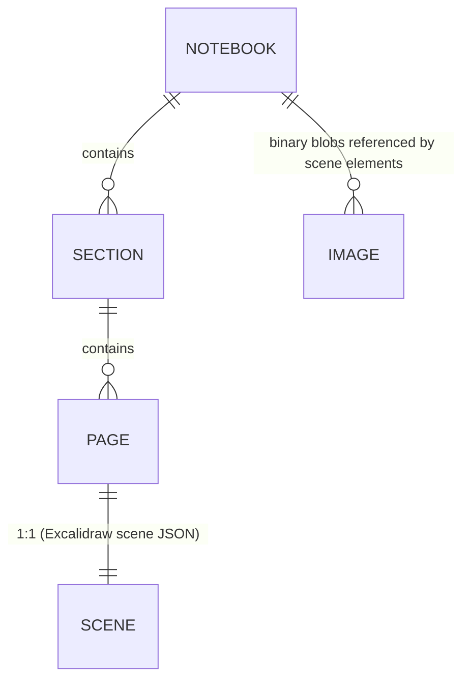

# Architecture

## Stack

| Layer | Choice |
|---|---|
| Framework | Next.js 16 (App Router), React 19, TypeScript |
| UI | Tailwind CSS 4 + shadcn/ui (Radix primitives), lucide icons |
| State | Zustand (`src/lib/store.ts`) |
| Storage | Dexie 4 over IndexedDB (client-only, offline) |
| Canvas | `@excalidraw/excalidraw` 0.18 (self-hosted fonts in `public/excalidraw/`) |
| PDF import | pdfjs-dist 4 with self-hosted worker (`public/pdf.worker.min.mjs`) |
| Word / OneNote-HTML import | pure extractors in `src/lib/` — `docx-import.ts` (fflate unzip + WordprocessingML scan), `html-import.ts` (tokenizer) → `ImportedBlock[]` |
| Delivery | PWA (manifest + custom service worker `public/sw.js`), standalone Next server build |

## Data model



- `src/lib/types.ts` defines Notebook / Section / Page (+ `BackupFile`), all with stable
  UUIDs, `order`, `createdAt`, `deletedAt` (soft delete / trash) and section color.
- A page's canvas content is its Excalidraw scene (elements + appState subset),
  persisted per page with a debounced autosave (700 ms) that is flushed on page switch.
- Images/PDFs are stored as binary blobs in IndexedDB and referenced by scene elements.

## Module map

```
src/lib/types.ts               data model + backup format
src/lib/notes-db.ts            Dexie schema v1: CRUD, trash cascade, backup build/restore,
                               fresh-id remapping, eraseAll
src/lib/tree-ops.ts            OneNote semantics: next-selection-after-delete, defaults
src/lib/search.ts              scene text extraction + ranked AND-match search
src/lib/store.ts               Zustand store: single-flight load(), welcome seed,
                               selection state, import/export actions
src/lib/excalidraw-utils.ts    SSR-safe pure helpers + CanvasApi contract
src/lib/excalidraw-client.ts   browser runtime: element/image/PDF/Word/HTML import,
                               structured-import layout, exports
                               (PNG/SVG/scene), serializeAsJSON
src/components/notes/          note-app (shell, menus, drag-drop import/export),
                               sidebar (tree, rename, colors, reorder), canvas-editor
                               (dynamic, ssr:false) + excalidraw-canvas, search-dialog,
                               trash-dialog, use-pwa hook
src/app/                       layout + single route "/" (client app)
```

## Key flows

1. **Boot** — `store.load()` (single-flight promise, prevents double-seed under
   double mounts) → loads tree from Dexie → seeds a welcome notebook on first run →
   first page auto-selected.
2. **Editing** — Excalidraw `onChange` → debounced persist of scene per page →
   immediate page switch flushes the pending save.
3. **Import** — file drop/picker → typed dispatch (image / text / md / pdf / scene)
   → pdf.js renders pages to images → `convertToExcalidrawElements` → scene update.
4. **Search** — iterate pages → extract scene text (via `search.ts`) → rank matches.
5. **Trash** — `deletedAt` timestamps cascade to children on delete; restore clears
   the timestamp; purge deletes rows and orphaned blobs.

## Testing strategy

- **Unit** (`src/lib/__tests__/`, 75 tests): tree-ops, search, excalidraw-utils,
  docx/html importers,
  notes-db (via `fake-indexeddb`, per-test DB reset). `bun test` runs them in ~0.6 s.
- **E2E** (`scripts/e2e.sh`, 34 checks): real browser against the dev server;
  app exposes `?e2e=1` hooks (`window.__NOTE_E2E__`, `window.__NOTE_RESET__`).
- **CI** (`ci.yml`): lint → typecheck → unit tests → production build → boot smoke.

## Constraints & known decisions

- All persistence is client-side (local-first, no server DB). The `prisma/` folder is
  unused sandbox scaffolding (see AGENTS.md "template leftovers").
- `next.config.ts` sets `output: "standalone"` (matches the `build`/`start` scripts)
  and keeps `ignoreBuildErrors` — type safety is enforced by CI's explicit
  `tsc --noEmit` step instead.
